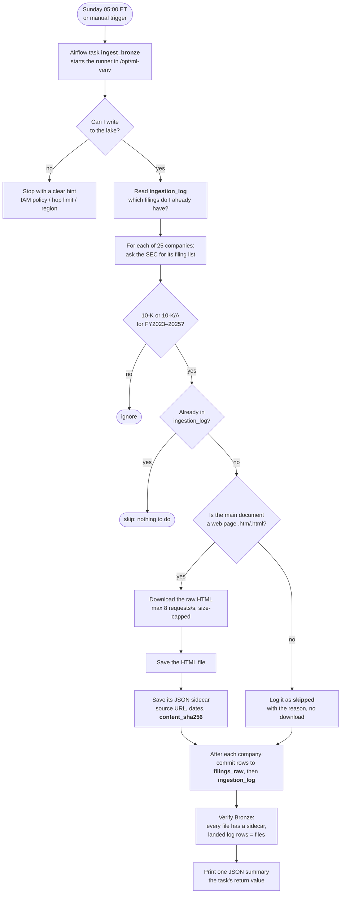
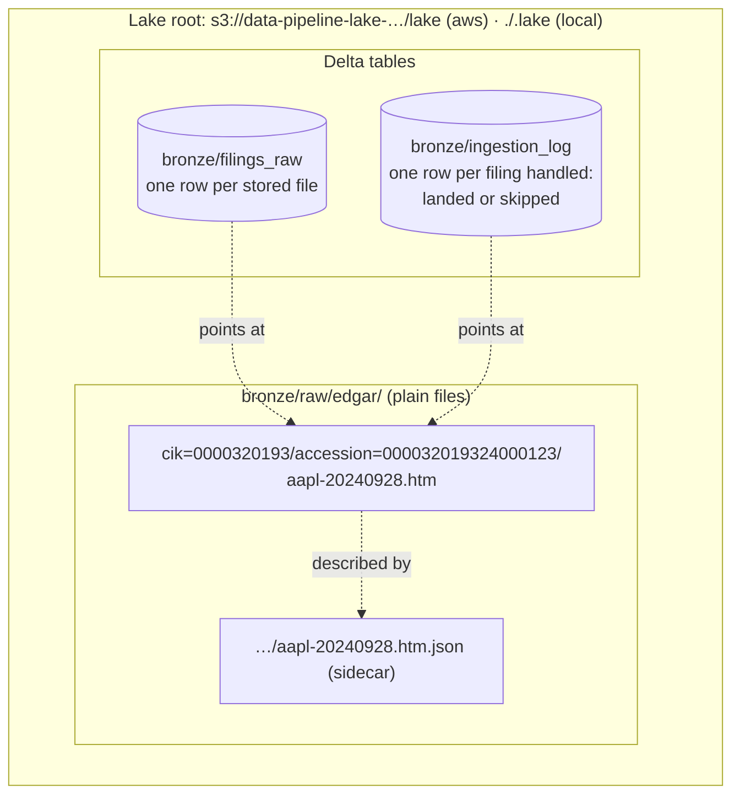
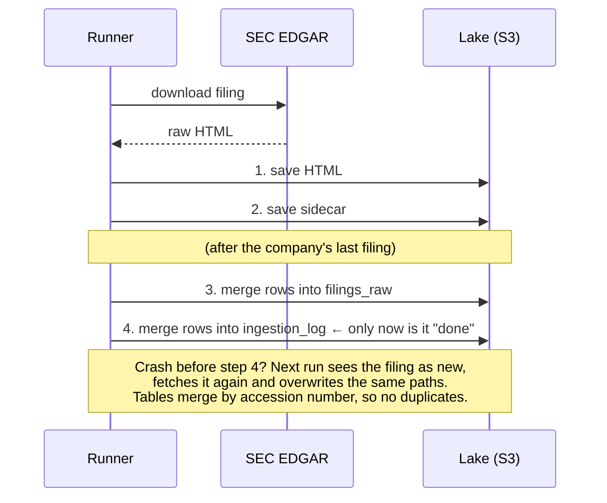
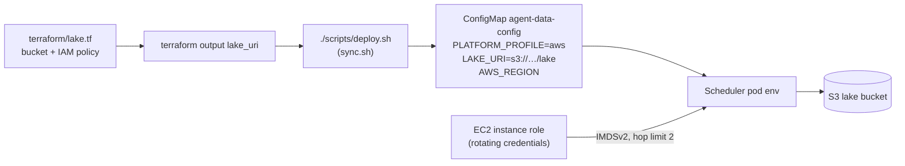

# EDGAR Documents DAG (Bronze ingest)

The `edgar_documents` DAG copies each company's yearly SEC report (the 10-K) into the **Bronze** layer of the lake, exactly as the SEC published it. "Bronze" is the first, untouched layer. Later steps parse it (Silver) and split it into searchable chunks (Gold).

- **Code:** [dag_edgar_documents.py](../../airflow/dags/agent_data_dags/dag_edgar_documents.py) → runner [run_bronze.py](../../agent_data/domains/edgar/run_bronze.py)
- **Schedule:** Sundays 05:00 ET, created **paused**, one run at a time
- **Scope:** 25 companies across 11 sectors × fiscal years 2023–2025, forms 10-K and 10-K/A ([companies.py](../../agent_data/domains/edgar/companies.py))

---

## The whole flow at a glance

A rerun follows the same path but stops at **"Already in ingestion_log?"** for every filing. It makes one cheap "list filings" call per company and **downloads nothing**.

---

## Where things are stored

| What | Format | Purpose |
|---|---|---|
| Raw filing | `.htm`, exact SEC bytes | The source of truth; never edited |
| Sidecar | `.htm.json` next to it | Where it came from, its dates, and a SHA-256 fingerprint (`content_sha256`) to prove the bytes are unchanged |
| `bronze/filings_raw` | Delta table | The catalog of stored files that the Silver parser reads next |
| `bronze/ingestion_log` | Delta table | The record of every filing handled: `landed`, or `skipped` with a `skip_reason` (`non_html`, `invalid_document_name`, `no_primary_document`) |

Raw files sit **outside** the Delta table folders on purpose. Delta's cleanup command (VACUUM) deletes any file in a table folder that its log doesn't know about.

---

## How a crash or a failure is handled

- **One download fails** (e.g. an SEC 404): it's listed in the summary's `failures`, the task fails so Slack alerts, and every other filing still lands. Because a failure is never logged as done, the next run retries it.
- **The SEC is slow or rate-limiting:** the client retries 429/5xx responses with backoff (honouring `Retry-After`), up to `EDGAR_MAX_RETRIES`.
- **The lake can't be written:** the runner stops before any SEC traffic, with a hint that names the likely cause.

---

## How the live box reaches its S3 lake (no access keys)

- **Credentials** are the EC2 instance role's. AWS rotates them automatically, and they survive spot replacement.
- **Hop limit:** pods can only reach those credentials with a metadata hop limit of 2. The launch template sets it, and the deploy pre-flight fixes it on an older instance.
- **Drift:** the ConfigMap is rebuilt from Terraform on every deploy, so it can't fall out of sync.

### What is a network hop, and why does Terraform mention it?

- **A hop** is one step a network message takes from one network to the next. Think of a letter going through a sorting office: every sorting office is one hop.
- **The metadata service** (`169.254.169.254`) is a small web address inside every EC2 server. Code on the server asks it for the server's **temporary AWS credentials**. That's how the pipeline gets into S3 without any stored access keys.
- **The hop limit** caps how many hops the service's reply may take before it's thrown away. AWS's usual default is **1**, so the reply reaches the server itself and nothing further. That's a security guard: it stops anything "behind" the server from grabbing the credentials.
- **Why it's 2 here:** the pipeline code runs inside a **Kubernetes pod**, a small virtual network inside the server. The reply has to cross one extra hop (server → pod). With a limit of 1 the pod never gets an answer and S3 access fails with a credentials error. With 2 the pod gets the reply, but anything further away still doesn't.
- **Where it's set:** `metadata_options` in [terraform/main.tf](../../terraform/main.tf) sets it for every new server. `_ensure_imds_hop_limit` in [scripts/deploy/common.sh](../../scripts/deploy/common.sh) checks the running server on every deploy and fixes it if it's still 1.

---

## Running it

| Where | Command |
|---|---|
| Airflow (live) | Unpause `edgar_documents`, or trigger it with `{"dry_run": true}` to preview what it would fetch. Unpausing immediately starts the most recent scheduled slot (normal Airflow behaviour with `catchup=False`), so the first load begins right away |
| Laptop (local profile, writes `./.lake`) | `.venv/bin/python -m agent_data.domains.edgar.run_bronze --tickers AAPL --years 2024` |
| Preview only | `… run_bronze --dry-run` |
| Audit Bronze | `… run_bronze --verify-only --deep` (re-hashes every stored file) |

SEC fair-access rules: a User-Agent with a contact email (`EDGAR_CONTACT_EMAIL`), and never more than 10 requests per second. The client stays at 8, and its setting can't be raised above 10.
